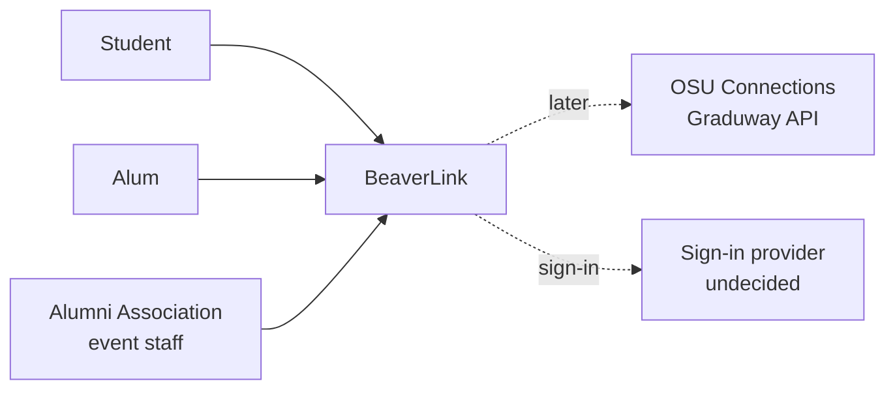
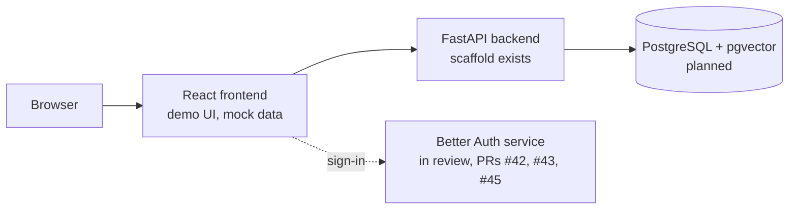

# BeaverLink Technical Design

## What Exists at This Commit

A FastAPI backend scaffold in `backend/` with one endpoint, `GET /health`, and one pytest test. A Vite + React + TypeScript frontend in `frontend/` with a front-end-only demo login (hardcoded accounts in `src/auth/demoUsers.ts`) and a role-based demo experience: a public landing page, and per-role dashboards (student, alumnus, organizer) that illustrate the planned recommendation flow — ranked matches with per-factor "why" breakdowns, event check-ins, and organizer matching-health views. All of it runs on fake in-memory fixtures in `src/data/` (people, events, attendees, computed matches); there is no backend integration, no real authentication, and no database schema yet. `supabase/config.toml` configures local PostgreSQL 17 for development, and CI uses the same major version. CI (`.github/workflows/ci.yml`) runs `ruff` and `pytest` for the backend and `tsc`, `eslint`, Vitest, and `vite build` for the frontend, on every pull request to `dev` and `main`; the frontend job activates now that `frontend/package-lock.json` exists.

The profile form at `/profile` validates student and alumni input but does not save it.

## Context

Zoom level: system context (BeaverLink as one box).

Students and alumni use BeaverLink before and during OSU Alumni Association events. Later, profiles may also be filled from OSU Connections (Gravyty's Graduway API).

## Containers

Zoom level: containers (the parts inside BeaverLink).

## Interfaces and Contracts

| Endpoint | Status | Contract |
| --- | --- | --- |
| `GET /health` | Built | Returns `200` with `{"status": "ok"}`. Tested by `backend/tests/test_health.py`. |

Planned rule: all data goes through FastAPI; the frontend never queries the database directly.

## Data Model

None yet. Planned tables: users, profiles, events, surveys, matches. If embeddings are adopted, they go in a separate `profile_embeddings` table so they can be dropped without touching anything else. Profiles and surveys are personal data (see `docs/requirements.md`, C-1).

## Deployment

**Production target.** The walking skeleton (sign in, fill a profile, see one ranked match list) will run as a hosted web app serving requests at a public URL by fall week 10. It runs on free cloud plans, on Vercel (picked in #10 on 2026-11-15) with Supabase as hosted PostgreSQL only (RFC accepted 2026-11-18), so it does not wait on OSU hosting. The partner, the OSU Alumni Association, agreed to free cloud hosting when the whole team asked at the in-person meeting on 2026-10-16. The accounts are registered to an email the partner provides, so the partner owns them and the team has access during the project. We asked for that email on 2026-11-06; the OSU Foundation is reviewing the request, so production waits on it (risk R1, #9). Owner: Benjamin Smithynunta.

**Supabase Data API.** Nothing calls Supabase's REST or GraphQL endpoints, so the Data API must be off before real data goes in. If the `better_auth` schema were exposed through it, `jwks` would leak the token signing key (anyone could forge tokens FastAPI accepts) and `account` would leak password hashes. `supabase/config.toml` still has `[api] enabled = true` for local development.

**Today.** The backend runs only locally (see README.md). Staging and rollback are planned in `docs/risks.md`.

## Decisions Deferred on Purpose

Database host and login library are decided: Supabase as hosted Postgres with Better Auth (accepted, `docs/rfcs/2026-10-25-supabase-benjamin-s.md`). The rest each have a proposed RFC, either in `docs/rfcs/` or in an open pull request:

- Profile data source and sign-in method (hybrid with swappable sources, proposed).
- Whether v1 matching uses stored embeddings (local model, separate table, off by default, proposed).

## Open Technical Questions

- Can Vercel's free plan run the Node auth service next to FastAPI? Untested until the RFC's spike (by 2026-12-06).
- Which OAuth providers can alumni use (Google, LinkedIn, OSU)?
- Does the CI Postgres image need extra extensions once migrations exist?
