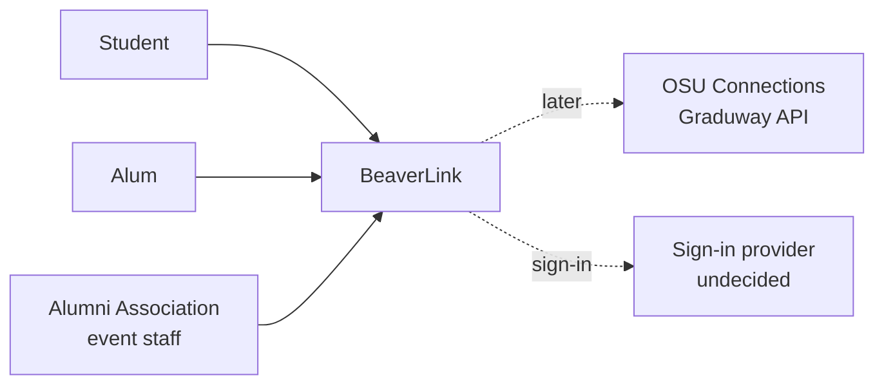
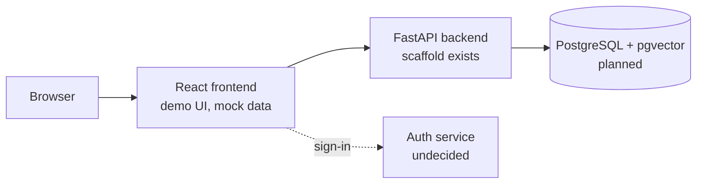

# BeaverLink Technical Design

## What Exists at This Commit

A FastAPI backend scaffold in `backend/` with one endpoint, `GET /health`, and one pytest test. A Vite + React + TypeScript frontend in `frontend/` with a public landing page, a stepped sign-up flow (`/signup`: email, then a password with a complexity check, then name and a role choice of student / alumnus / guest), a role-specific profile-onboarding step (`/onboarding/profile`) that collects a photo upload and optional LinkedIn-style work-experience and education history on top of the role's base fields, and a restyled sign-in page (`/login`, with a dev-only demo-account autofill behind `import.meta.env.DEV`) — plus a role-based demo experience: per-role dashboards (student, alumnus, organizer) and a minimal guest home that illustrate the planned recommendation flow — ranked matches with per-factor "why" breakdowns, event check-ins, and organizer matching-health views. All of this runs on a mock `AuthProvider` backed by `localStorage` (including the hardcoded demo accounts in `src/auth/demoUsers.ts`) and fake in-memory fixtures in `src/data/` (people, events, attendees, computed matches); there is no backend integration, no real authentication, and no database schema yet — real auth via FastAPI and Supabase-Postgres is a Phase 2 item deferred on purpose (see RFCs below). `supabase/config.toml` configures local PostgreSQL 17 for development, and CI uses the same major version. CI (`.github/workflows/ci.yml`) runs `ruff` and `pytest` for the backend and `tsc`, `eslint`, Vitest, and `vite build` for the frontend, on every pull request to `dev` and `main`; the frontend job activates now that `frontend/package-lock.json` exists.

The profile form at `/profile` (and the onboarding step at `/onboarding/profile`) validates student, alumni, and guest input and saves it to the mock `AuthProvider`'s `localStorage` store; there is still no backend persistence or server-side access check.

## Context

Zoom level: system context (BeaverLink as one box).

Students and alumni use BeaverLink before and during OSU Alumni Association events. Later, profiles may also be filled from OSU Connections (Gravyty's Graduway API).

## Containers

Zoom level: containers (the parts inside BeaverLink).

## Interfaces and Contracts

| Endpoint | Status | Contract |
| --- | --- | --- |
| `GET /health` | Built | Returns `200` with `{"status": "ok"}`. Tested by `backend/tests/test_health.py`. |

Planned rule: all data goes through FastAPI; the frontend never queries the database directly.

## Data Model

None yet. Planned tables: users, profiles, events, surveys, matches. If embeddings are adopted, they go in a separate `profile_embeddings` table so they can be dropped without touching anything else. Profiles and surveys are personal data (see `docs/requirements.md`, C-1).

## Deployment

**Production target.** The walking skeleton (sign in, fill a profile, see one ranked match list) will run as a hosted web app serving requests at a public URL by fall week 10. It runs on free cloud plans, with managed PostgreSQL (Supabase is proposed in an open RFC), so it does not wait on OSU hosting. The partner, the OSU Alumni Association, agreed to free cloud hosting when the whole team asked at the in-person meeting on 2026-10-16. The accounts are registered to an email the partner provides, so the partner owns them and the team has access during the project. That email has not been requested yet (see `docs/risks.md`). The specific host is not picked yet; the free plans under consideration are Vercel and Cloudflare. Owner: Benjamin Smithynunta, by 2026-11-08.

**Today.** The backend runs only locally (see README.md). Staging and rollback are planned in `docs/risks.md`.

## Decisions Deferred on Purpose

Each has a proposed RFC, either in `docs/rfcs/` or in an open pull request:

- Database host and login library (Supabase Postgres with Better Auth, proposed).
- Profile data source and sign-in method (hybrid with swappable sources, proposed).
- Whether v1 matching uses stored embeddings (local model, separate table, off by default, proposed).

## Open Technical Questions

- Can Vercel or Cloudflare's free plan run FastAPI, and a Node auth service next to it if Better Auth is chosen?
- Which OAuth providers can alumni use (Google, LinkedIn, OSU)?
- Does the CI Postgres image need extra extensions once migrations exist?
