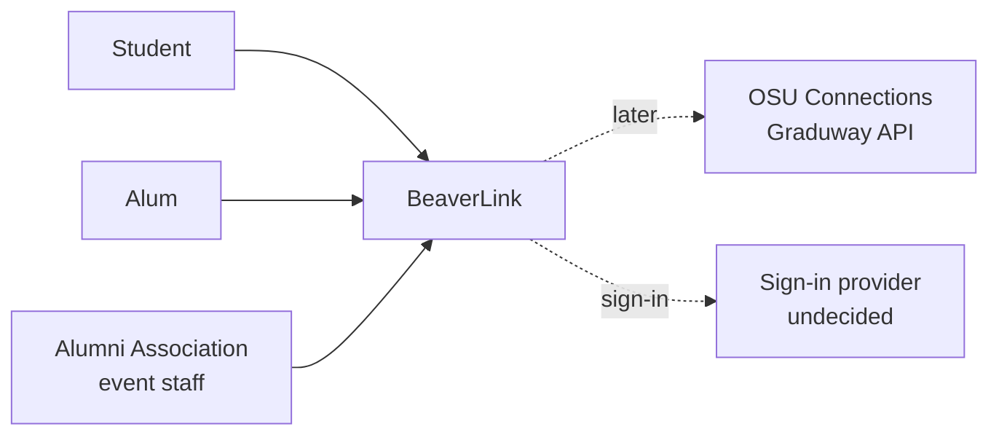
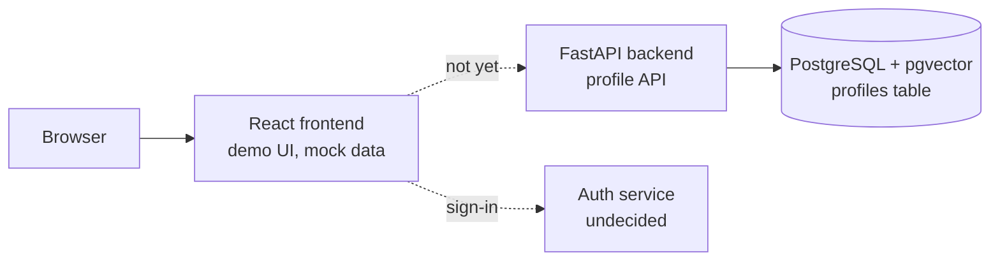

# BeaverLink Technical Design

## What Exists at This Commit

A FastAPI backend in `backend/` with `GET /health` and the profile endpoints (`GET` and `PUT /profiles/me`), which store profiles in PostgreSQL. The profile endpoints reject every request with `401` until FastAPI checks Better Auth tokens. A Vite + React + TypeScript frontend in `frontend/` with a front-end-only demo login (hardcoded accounts in `src/auth/demoUsers.ts`) and a role-based demo experience: a public landing page, and per-role dashboards (student, alumnus, organizer) that illustrate the planned recommendation flow — ranked matches with per-factor "why" breakdowns, event check-ins, and organizer matching-health views. All of it runs on fake in-memory fixtures in `src/data/` (people, events, attendees, computed matches); the frontend does not call the backend yet, and there is no real authentication. `supabase/config.toml` configures local PostgreSQL 17 for development, and CI uses the same major version. CI (`.github/workflows/ci.yml`) runs `ruff` and `pytest` for the backend and `tsc`, `eslint`, Vitest, and `vite build` for the frontend, on every pull request to `dev` and `main`; the frontend job activates now that `frontend/package-lock.json` exists.

The profile form at `/profile` validates student and alumni input but is not connected to the profile API yet.

## Context

Zoom level: system context (BeaverLink as one box).

Students and alumni use BeaverLink before and during OSU Alumni Association events. Later, profiles may also be filled from OSU Connections (Gravyty's Graduway API).



## Containers

Zoom level: containers (the parts inside BeaverLink).



## Interfaces and Contracts

| Endpoint | Status | Contract |
| --- | --- | --- |
| `GET /health` | Built | Returns `200` with `{"status": "ok"}`. Tested by `backend/tests/test_health.py`. |
| `GET /profiles/me` | Built, returns `401` until the token check exists | Returns `200` with the signed-in user's profile, or `404` if they have not created one yet. Tested by `backend/tests/test_profiles.py`. |
| `PUT /profiles/me` | Built, returns `401` until the token check exists | Creates or replaces the signed-in user's profile. Returns `200` with the saved profile, or `422` with the invalid fields. Tested by `backend/tests/test_profiles.py`. |
| `PUT /events/{event_id}/survey` | Planned | Saves the signed-in user's survey answers for one event. Fields are not decided yet. |
| `GET /events/{event_id}/matches` | Planned | Returns the signed-in user's ranked matches for one event, highest score first (see the match shape below). |
| `POST /events/{event_id}/check-in` | Planned | Marks the signed-in user as arrived, so live matching can skip no-shows. |

Planned rule: all data goes through FastAPI; the frontend never queries the database directly.

Every endpoint except `/health` requires a Better Auth token in `Authorization: Bearer <token>`, which FastAPI checks against Better Auth's public keys. A missing or invalid token gets `401`. Users can only reach their own profile, because there is no endpoint that takes another user's ID.

**Profile.** JSON fields use snake_case.

```json
{
  "profile_type": "alumnus",
  "student_year": null,
  "graduation_year": 2015,
  "major": "Computer Science",
  "industry": "Healthcare",
  "job_title": "Software Engineer",
  "goals": ["Mentor a student"],
  "goal_details": "",
  "updated_at": "2026-11-20T18:00:00Z"
}
```

- `profile_type` is `student` or `alumnus`. Someone who is both (an OSU grad now in an OSU grad program) picks how they want to be matched and can change it later. Event roles and admin rights are stored separately, not on the profile.
- Students need `student_year` (`First year` through `Fifth year or later`, or `Graduate student`) and `major`. Alumni need `graduation_year` (four digits, not in the future) and `industry`. Fields for the other profile type are cleared, not stored.
- `goals` needs 1 to 10 entries. `job_title` and `goal_details` are optional.
- Text is trimmed. Fields are limited to 100 characters, except `goal_details`, which allows 1000.
- When a user picks "Other" for industry, `industry` holds the text they typed.

**Match.** Per FR-5, the factor scores add up to the match score.

```json
{
  "person_id": "p-123",
  "score": 82,
  "factors": [
    { "key": "complementary-goals", "label": "Complementary goals", "weight": 40, "score": 35, "explanation": "You want a mentor and they mentor students." }
  ]
}
```

## Data Model

**Built:** `profiles`, one row per user, keyed by the Better Auth user ID. Its columns match the profile fields above, and it has no foreign key to Better Auth's `user` table because that table lives in the auth service's schema. Schema changes are SQL files in `backend/migrations/`, each with a down step, applied with `python -m app.migrate up` and rolled back with `python -m app.migrate down`. Backend tests apply them to CI's Postgres and test the rollback.

**Planned tables:** events, surveys, matches. If embeddings are adopted, they go in a separate `profile_embeddings` table so they can be dropped without touching anything else. Profiles and surveys are personal data (see `docs/requirements.md`, C-1).

## Deployment

**Production target.** The walking skeleton (sign in, fill a profile, see one ranked match list) will run as a hosted web app serving requests at a public URL by fall week 10. It runs on free cloud plans, with managed PostgreSQL (Supabase is proposed in an open RFC), so it does not wait on OSU hosting. The partner, the OSU Alumni Association, agreed to free cloud hosting when the whole team asked at the in-person meeting on 2026-10-16. The accounts are registered to an email the partner provides, so the partner owns them and the team has access during the project. That email has not been requested yet (see `docs/risks.md`). The specific host is not picked yet; the free plans under consideration are Vercel and Cloudflare. Owner: Benjamin Smithynunta, by 2026-11-08.

**Today.** The backend runs only locally (see README.md). Staging and rollback are planned in `docs/risks.md`.

## Decisions Deferred on Purpose

Each has a proposed RFC, either in `docs/rfcs/` or in an open pull request:

- Database host and login library (Supabase Postgres with Better Auth, proposed).
- Profile data source and sign-in method (hybrid with swappable sources, proposed).
- Whether v1 matching uses stored embeddings (local model, separate table, off by default, proposed).

## Open Technical Questions

- Can Vercel or Cloudflare's free plan run FastAPI, and a Node auth service next to it if Better Auth is chosen?
- Which OAuth providers can alumni use (Google, LinkedIn, OSU)?
- Does the CI Postgres image need extra extensions once migrations exist?
